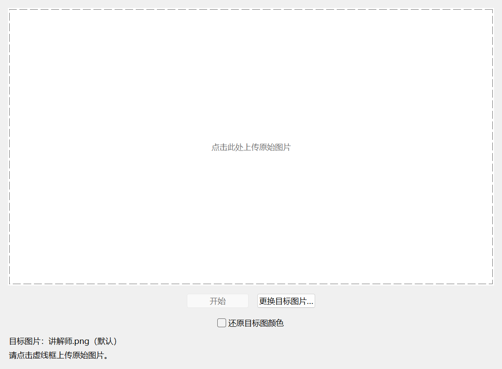
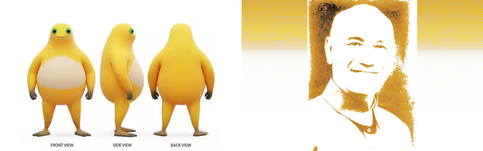

# generate-Mr.chiang

讲解石生成器，一个 Windows 原生风格的像素拆解重排程序。

[下载 Windows 便携版 v1.0.0](https://github.com/MYFSillyBa/generate-Mr.chiang/releases/download/v1.0.0/generate-Mr.chiang-v1.0.0-windows-x64.zip) · [所有发布版本](https://github.com/MYFSillyBa/generate-Mr.chiang/releases)

Windows 原生风格桌面程序。默认目标为用户提供的“讲解师.png”，已内置到程序中。上传原图后点击开始，原图像素会拆开、搬运、重新排列成目标结构。图片只在本机处理，不联网。

## 使用

下载便携版 ZIP 并解压，双击 **讲解石生成器.exe**，无需安装 Python。项目工作目录中也可以双击 **启动程序.bat**。



1. 点击虚线框，上传原始图片。
2. 点击“开始”。动画约 5.5 秒，在同一个虚线框内播放。颗粒为 **1 像素**，每个像素独立移动，不再组合为大模块；背景没有完整图片叠化。

“还原目标图颜色”默认不勾选：**仅重新排列原图像素，RGB 颜色和亮度均不替换**，最终各颜色像素的数量与适配后的原图完全相同。目标图只提供排列位置的参考，不向结果补入目标图的灰度、纹理像素或颜色。因此浅色原图的结果仍会保持浅色，纯白原图仍为纯白。勾选后：像素落位时逐渐改成目标图颜色，最终得到完整目标图。切换选项会回到起点。

如需使用其他目标图片，点击“更换目标图片…”。每次启动默认使用内置的“讲解师.png”；移动 exe 到其他位置也可以正常使用，无需桌面上的原文件。

开始按钮在播放时切换为“暂停”，暂停后可继续，完成后可重新开始。点击画面可更换原图，点击“更换目标图片…”可更换目标。

右键点击画面，选择“保存当前图片…”可导出当前帧 PNG，尺寸为 960 × 600。支持 PNG、JPG、WebP、BMP、TIFF、GIF（读取第一帧）及 Pillow 可读取的 AVIF。图片等比完整显示，不裁剪；原图补边从原图边缘取色，不再人为添加深色。透明区域按原图边缘色铺底。动画是视觉变换，不使用生成式 AI 或训练神经网络。

快捷键：空格开始/暂停，Esc 暂停，Ctrl+O 上传原图，Ctrl+T 上传目标图，Ctrl+S 保存当前画面。

## 从源码运行

需要 Python 3.11 或更新版本，包含 Tkinter（Windows 官方 Python 默认包含）。

```powershell
python -m pip install -r requirements.txt
python app.py
```

## 测试与重新打包

```powershell
python -m unittest discover -s tests -v
powershell -ExecutionPolicy Bypass -File .\build.ps1
```

构建后可运行以下命令生成 ZIP 和 SHA256 校验文件：

```powershell
python tools/package_release.py
```

源码结构：

- `app.py`：原生界面、上传、播放与导出。
- `morph_engine.py`：图像读取、适配与渲染入口。
- `piece_transition.py`：像素的一对一匹配与拆解重排。
- `assets/`：内置目标图、图标和说明图片。
- `tests/`：图像与桌面回归测试。

不勾选还原颜色时的效果（左为原图，右为仅重排像素的结果）：


